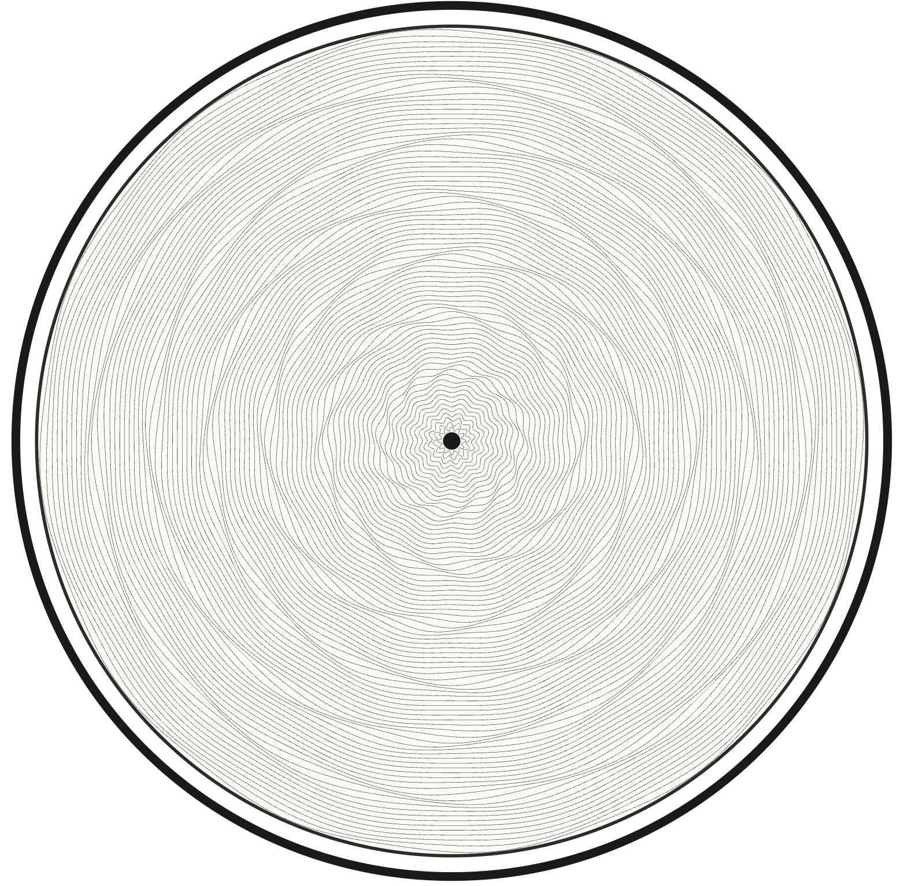

# Pattern models

Why can two turtles objects produce similar decoration but behave differently when inspected or exported? The answer depends on what each object models: a mathematical curve, an arrangement of curves, or a simplified sequence of engine passes. A family name describes a visual construction in this library; it does not establish that every implementation with that name represents the same machine motion.

## Direct layers describe the drawing

A direct layer computes points from its geometry and stores them as one or more ordered paths. A spirograph follows one parameterized curve. Other families produce collections of rings, circles, figure-eights, or passes. The visible texture comes from the relationship between those paths, often without any surface model behind them.

`GuillochePattern` collects the supported direct layer families and generates each independently. It retains their paths rather than merging intersections into a surface or subtracting one layer from another. Overlapping a small pattern with a background therefore adds lines; it does not reserve a blank subdial region.

`WatchFace` wraps that composition with dial, bezel, and hole decorations for SVG. This distinction separates the pattern's line geometry from the drawing used to present it. A rendered hole can cover underlying ink without removing the corresponding paths from the composition.

### Rolling curves and repeated loops

The horizontal spirograph uses a hypotrochoid: a point associated with a circle rolling inside a larger circle. The radius ratio sets the relative rolling motion, while the pen offset sets the size of the loops. In this implementation, `point_distance` is a fraction of the rolling circle's radius, not an absolute distance in millimeters. Values above one put the pen outside that circle and can extend the curve beyond its nominal outer radius.

The vertical variant adds a sinusoidal displacement to the y coordinate of the same base curve. “Vertical” describes an extra in-plane wave, not a second physical plane. The spherical variant retains the planar trace and also computes points on a dome. Its SVG uses the planar trace; its standalone 3D exports can retain dome height. That height is lost when the layer enters the combined composition's 2D path collection.

The number of rotations controls how far a spirograph is traced. It does not guarantee closure. Closure depends on the relationship between the rolling frequencies and the traced interval, so an unfinished trace can have separate endpoints even when it looks nearly periodic.

Diamant, limaçon, and huit-eight also build meshes from repeated curves, but use different primitives:

- **Diamant** distributes equal circles whose centers are one circle radius from the layer center. Every circle passes through that center; their overlaps create the diamond-like mesh. The outer reach of a circle is twice its own radius.
- **Limaçon** distributes phase-shifted polar curves with radius $a + b\\sin(\\theta + \\phi)$. Changing the balance between base radius and amplitude changes the curve from a rounded outline through a cusp to an inner loop when the amplitude exceeds the positive base radius. The default equal values give the cusp case.
- **Huit-eight** rotates Bernoulli lemniscates, or figure-eights, through the layer center. A figure-eight is unchanged by a half-turn, so the implementation distributes orientations over $\\pi$ radians rather than repeating the same strokes over a full turn. Clustering gathers those orientations into bundles, producing petals and gaps instead of a uniform mesh.

These existing gallery images illustrate the families. They are not a promise that every parameter choice yields the same density, outline, or symmetry.

### Rings, folds, and apparent relief

Flinqué builds concentric rings with a repeated absolute-sine radial displacement. Each ring has pointed troughs, rounded peaks, and a smaller sinusoidal ripple. Petal count controls the main lobes around a ring; ring count controls how many traces fill the radial band. The ripple frequency affects detail along a trace, not the number of concentric rings. The nominal outer radius positions the ring band, but the added displacement can extend beyond it.

Draperie uses concentric wavy rings whose peaks shift sideways as the radius changes. A single ring is a radial wave; the apparent fabric folds emerge from the alignment of many rings. Its base radius is the center of the ring band, not the innermost radius. With $N$ rings and spacing $s$, ring $i$ has nominal radius

$$
R_i = R_0 + \\left(i - \\frac{N-1}{2}\\right)s.
$$

The phase applied to that ring is an angular offset, multiplied by the wave frequency inside the radial sine. The cross-ring variation is

$$
\\phi_i = S,F\\left(\\frac{2\\pi C i}{N}\\right),
$$

where $S$ is the phase-shift amplitude, $C$ is the number of phase oscillations across the stack, and $F$ controls the fold shape. This variation is separate from the wave that travels around each ring.

When `circular_phase` is positive, $F$ uses a signed dome envelope:

$$
F(t) = \\operatorname{sgn}(\\sin t)\\left[1-(1-|\\sin t|)^n\\right].
$$

Larger $n$ gives a broader dwell near the envelope's extremes. When `circular_phase` is zero, the implementation instead uses the signed sine-power envelope

$$
F(t) = \\operatorname{sgn}(\\sin t)|\\sin t|^e.
$$

Here `phase_exponent` sets $e$. It has no effect while dome mode is active. `wave_exponent` changes the radial wave within each ring, independently of either cross-ring phase envelope. A change in fold shape and a change in the crest of an individual ring can therefore look related while coming from different controls.

Draperie's automatic amplitude estimates the largest adjacent phase difference numerically, combines a ring-separation limit with an inner-radius limit, and applies a safety factor. This explains why changing phase can also change the automatically selected wave height. It is an implementation heuristic, not a collision proof for every waveform and configuration. In Rust, an explicit amplitude bypasses that automatic choice; it is not subsequently clamped during generation.

### Fans and straight-line constructions

Paon's feather-like arches come from a fan of oscillating traces. The current generator places a vanishing point below the circle in SVG coordinates, spreads lines by angle, and adds horizontal oscillation. Oscillation phase varies logarithmically with distance from the vanishing point, so wavelengths grow toward the top of the image. A phase envelope across the fan creates the arch columns.

This geometry differs from older comments describing parallel horizontal passes. Despite its name, `fan_angle` scales the cross-fan phase envelope in wave-cycle units; the fan's geometric spread is computed from the circle and vanishing point. Additional Fourier harmonics sharpen the oscillation toward a triangle wave. The resulting density bands suggest feather edges without defining raised or recessed feather-shaped faces.

Clous de Paris uses two perpendicular sets of straight lines, trimmed to a local circle. Their rotation changes whether the grid reads as squares or diamonds. The drawing represents groove centerlines; the pyramidal hobnails associated with a physical cut are not modeled as solid facets.

Cube uses grouped, parallel zigzags with gaps between groups. Neighboring groups shift by half a period so peaks nest into troughs. The gaps and zigzag slopes create the tumbling-block illusion. The current generator does not use three sets of straight lines at 60-degree offsets, despite an older description in the rose-engine run code.

## Rose-engine simulation describes displacement and passes

The general rose-engine model starts with spindle angle. A rosette supplies radial displacement, scaled by amplitude and added to a base radius. A secondary rosette can add another displacement. `RoseEngineLathe` samples that radius over an angular interval and derives a tool centerline, approximate left and right cut edges, and optional depth and shading values.

This is a geometric simulation of selected engine behavior. The cut edges are offsets by half the configured bit width along an estimated path normal. They are not a full sweep of the bit's cross-section through stock, and they do not resolve overlapping cuts or self-intersections.

`RoseEngineLatheRun` repeats passes. In its ordinary phase-rotation mode, each pass advances the primary rosette phase. With a nonzero radius step, it instead distributes base radii around the configured radius and can vary phase across that ring stack. The general run can also break traces into pieces with drawing gaps. Those gaps are a preview convention based on sampled point counts, not a planned retract-and-approach sequence.

Named run constructors do not all follow this general simulation path. Limaçon uses the ordinary sinusoidal radial model, and draperie configures concentric passes. Diamant, huit-eight, flinqué, paon, clous de Paris, and cube have dedicated generation branches that reproduce their direct mathematical constructions. Those branches produce line collections without populating the individual lathe-pass collection. Similar output is intentional, but it does not prove that a physical engine can reproduce the drawing with the represented setup.

A generic rosette named `HuitEight` or `Diamant` is also distinct from the dedicated constructor for that direct family. The former is a radial displacement function; the latter constructs the corresponding figure-eights or circles. Matching names alone do not imply matching paths.

## Sampling changes what can be seen

The exported paths approximate curves with straight segments. Resolution controls the samples along a path, while ring count, curve count, and pass count control how many paths exist. Adding curves increases pattern density; adding samples improves the representation of each curve. Those changes solve different problems.

Uniform angular sampling is not uniform distance sampling on most modulated curves. Sharp corners, tight loops, high-frequency ripples, and additional harmonics can need more samples than broad smooth sections. If samples land at repeating phases of a wave, the sampled output can suppress or misrepresent that wave. This is geometric aliasing: detail is already absent or wrong in the stored points, before any image viewer draws it. A custom rosette's lookup table introduces another sampling limit that a finer spindle-angle grid cannot fully undo.

Resolution is not a universal quality control. Flinqué derives its angular sample count from petal count. Clous de Paris adds samples along already straight lines, so extra points do not reveal more curvature. Cube constructs its sharp zigzag vertices directly and keeps its `resolution` field for compatibility rather than using it to refine those vertices.

There is also display aliasing. Dense paths can form moiré bands or merge into dark regions when a vector drawing is rasterized at a particular zoom. That appearance can change without any change in geometry. Some density effects are the intended motif, especially in paon; a screenshot alone cannot distinguish those effects from missing samples or certify physical groove clearance.

## Python and Rust share the geometry, not every interface

The Rust core implements the curve generation, composition, clipping, and exporters described here. The PyO3 extension wraps those types, translates arguments and errors, and presents point collections as Python tuples. The public Python package re-exports the extension classes and adds a convenience `WatchFace` wrapper. It is not a second Python implementation of the pattern mathematics.

That shared core does not make the interfaces interchangeable. Rust commonly accepts configuration structs, while Python constructors and convenience methods collect scalar arguments. Some Rust settings or inspection methods are not exposed by the bindings. Python's `WatchFace` also declares subdial and window helpers that currently raise `NotImplementedError`; an offset pattern layer is not the same feature as either helper.

The [pattern reference](../reference/patterns.md) describes the direct interfaces, the [composition reference](../reference/composition.md) describes how layers are collected, and the [rose-engine reference](../reference/rose-engine.md) distinguishes the simulation interfaces. [Coordinates](coordinates.md) explains placement and boundaries; [geometry and exports](geometry-and-exports.md) explains which parts of these models reach each output format.
