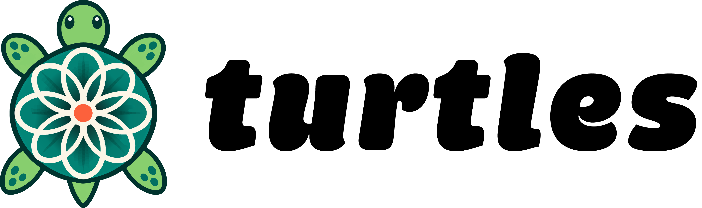

# turtles documentation

Turtles generates spirograph and guilloché patterns with a Rust geometry library
and Python bindings. Create standalone motifs, assemble textured watch dials, or
model single-pass and multi-pass rose-engine patterns.

The Python distribution is **pyturtles**; its import name is **turtles**. The Rust
library crate is **turtles**. Python requires version 3.11 or later.

## Tutorials

[Tutorials](tutorials/index.md) provide a guided path from a first SVG to a
composed dial and a rose-engine run. Start with
[your first pattern](tutorials/first-pattern.md); each lesson includes the result
to check before continuing.

## How-to guides

[How-to guides](how-to/index.md) cover installation, positioning and composition,
exports, and development. Use them when you have a particular task to complete.

## Reference

[Reference](reference/index.md) describes constructors, defaults, units,
properties, validation, and supported output. The
[pattern gallery](reference/gallery.md) connects the motif names to existing
preview images and example programs.

## Explanation

[Explanation](explanation/index.md) discusses pattern construction, coordinates,
sampling, clipping, and the differences between a drawing and manufactured
geometry. Read [geometry and exports](explanation/geometry-and-exports.md) before
treating an exported file as a machining model.

## Scope

SVG is a vector preview. Working STEP exporters contain sampled curves rather
than solids. STL exporters produce simple triangle ribbons, not watertight
plates or swept grooves. Export availability differs by class; see the
[export matrix](reference/exports.md).

Subdial and date-window rendering are not implemented. JavaScript bindings are
not currently included. These pages describe the checked-in implementation, not
unreleased roadmap features.

Source and issues: [1kbgz/turtles](https://github.com/1kbgz/turtles).
License: [Apache-2.0](https://github.com/1kbgz/turtles/blob/main/LICENSE).
