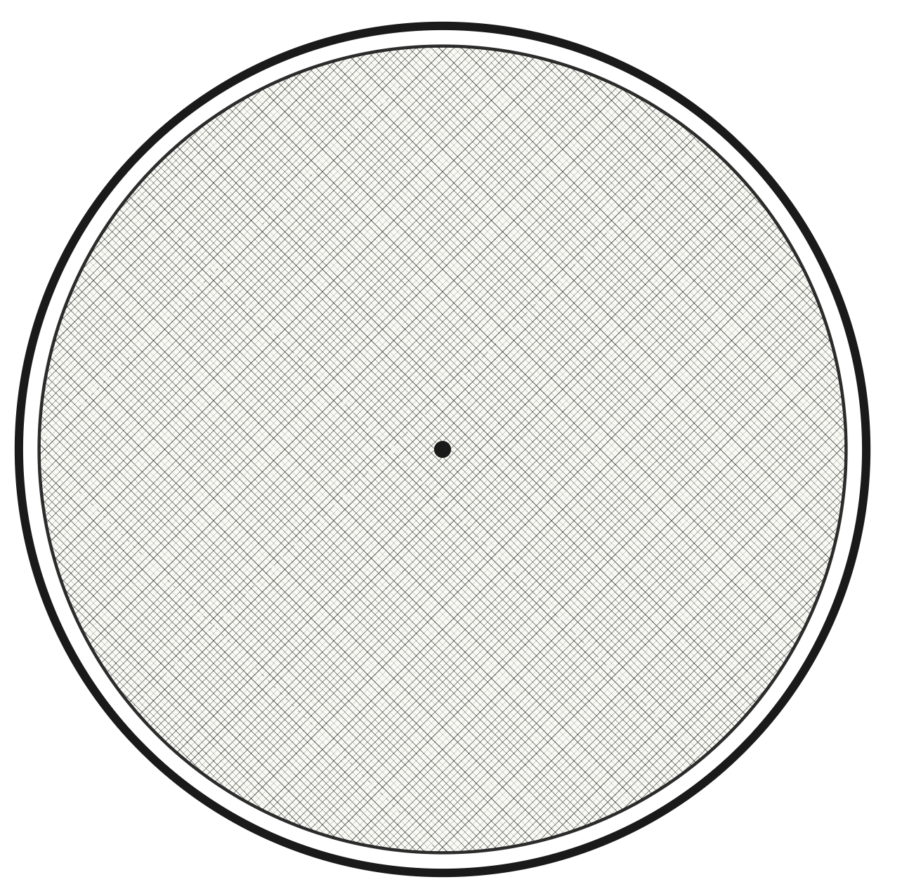
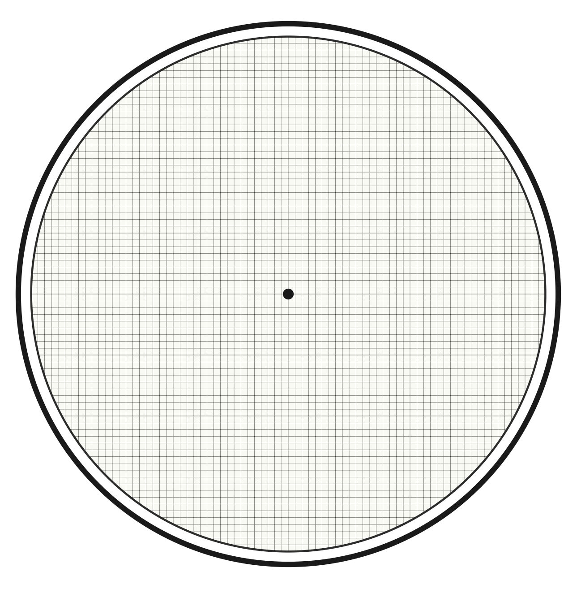
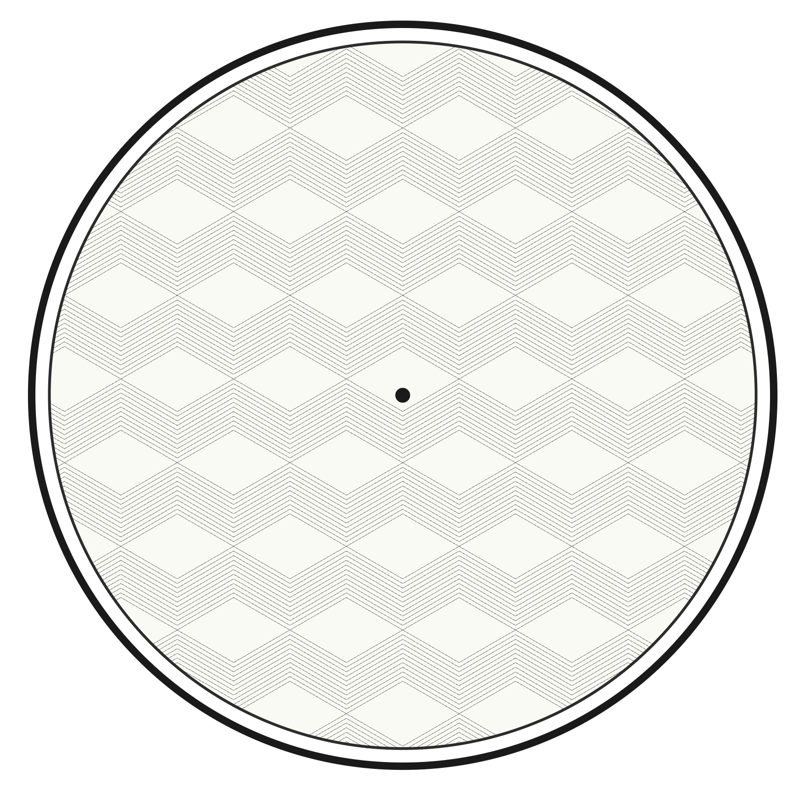
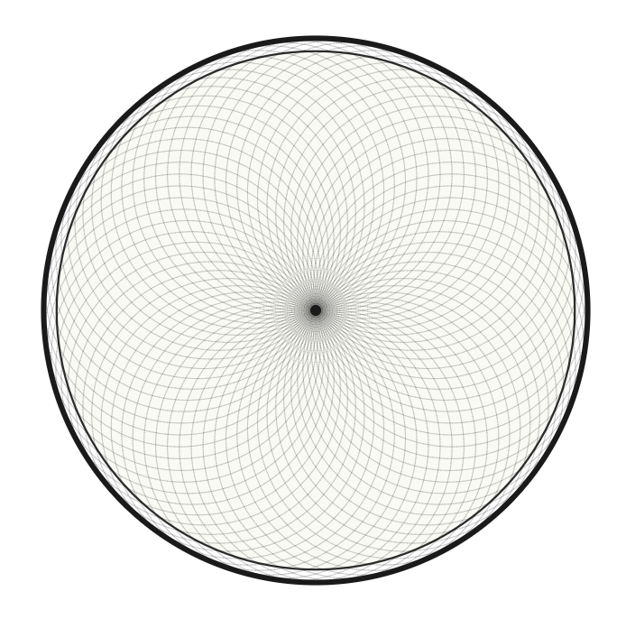
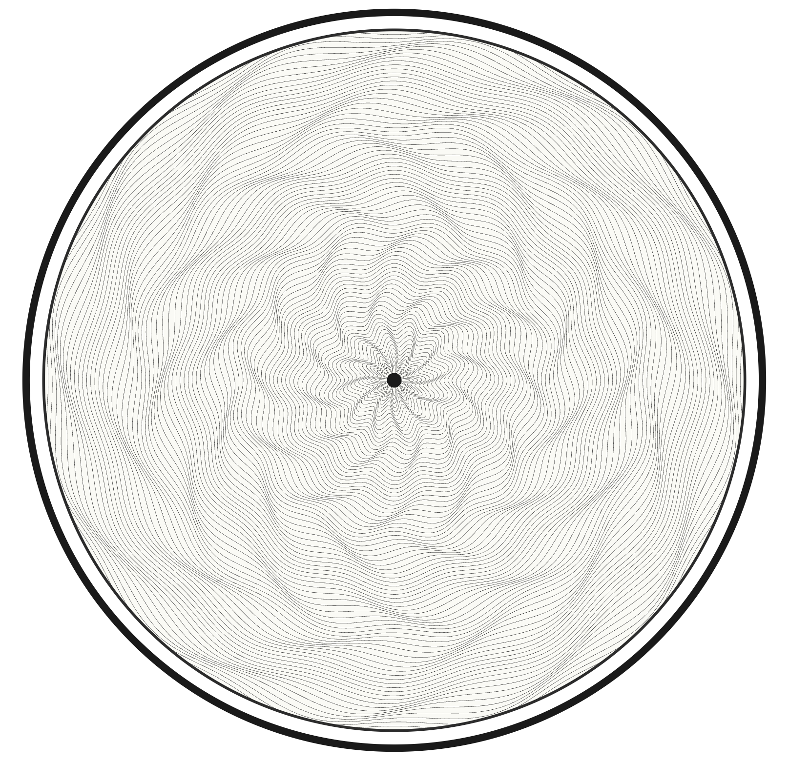
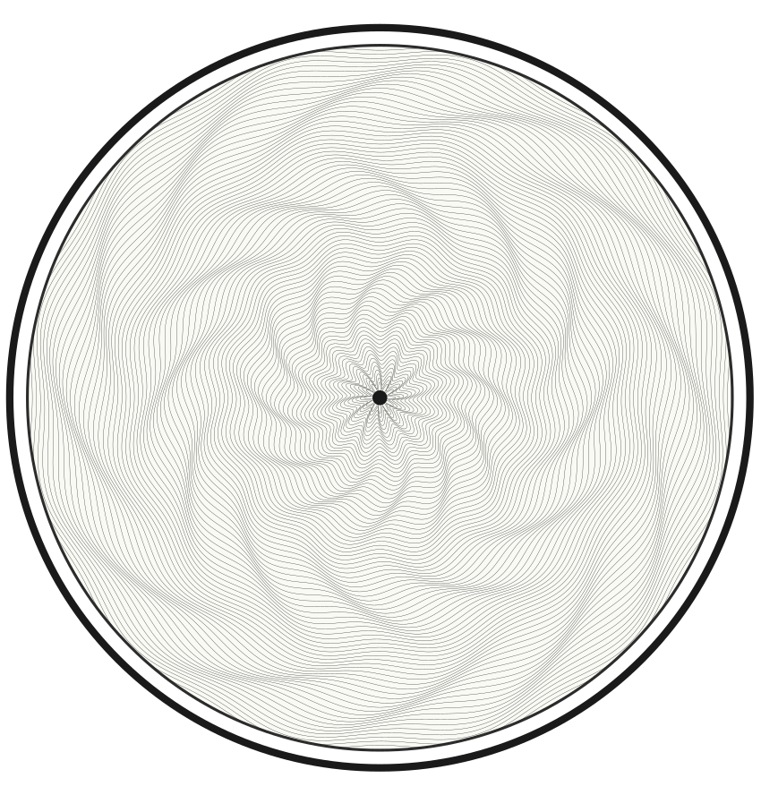
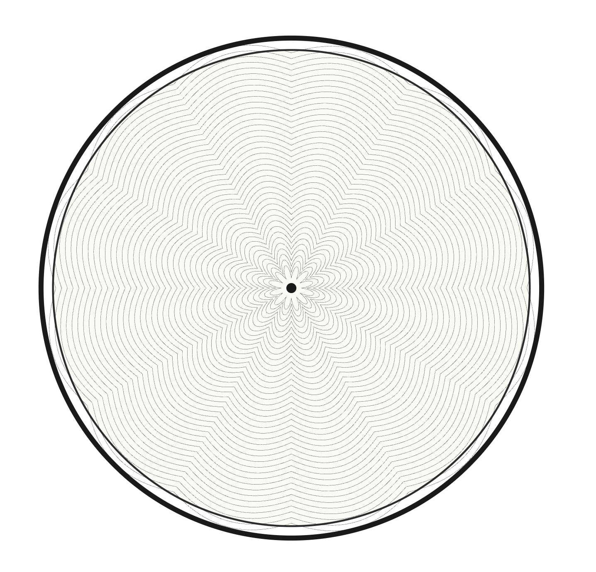
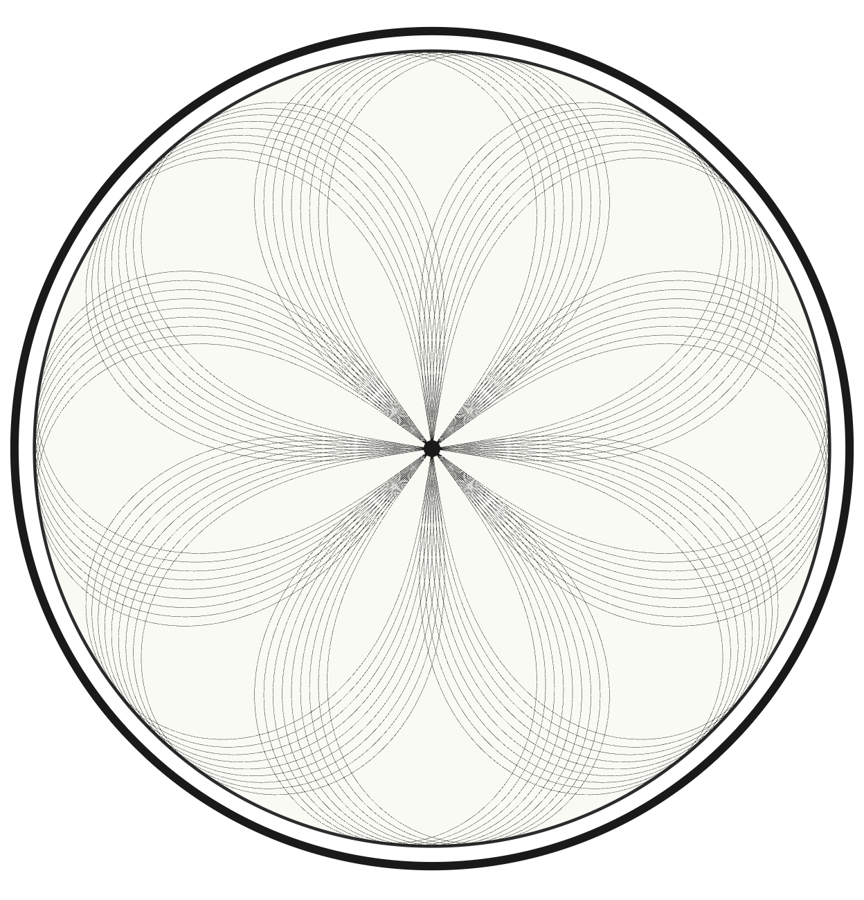
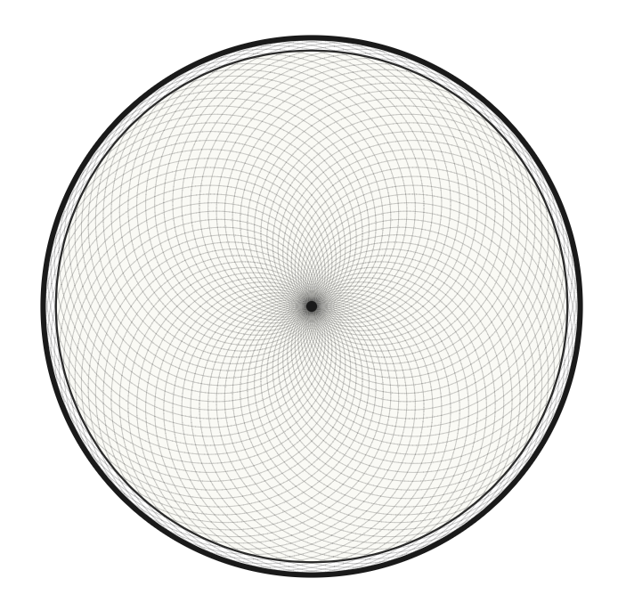
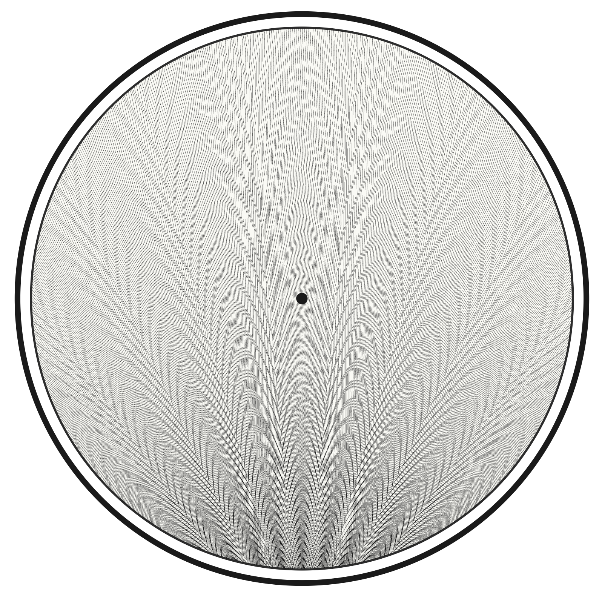

# Pattern gallery

These images are existing project previews. They identify motif families; they
are not a rendering guarantee for every parameter combination. The linked
example programs contain the configurations used for variations of each family.
Python example programs write under `examples/svg` when run from the repository
root; the [development guide](../how-to/develop.md) describes environment setup.

## Clous de Paris

Two perpendicular sets of straight grooves form a hobnail grid. The square
variant changes grid rotation to zero.

API: {ref}`ClousDeParisLayer <clousdeparislayer>`.
[Example program](https://github.com/1kbgz/turtles/blob/main/turtles/examples/clous_de_paris.py).

## Cube

Grouped zigzag grooves and shifted gaps produce the tumbling-blocks appearance.

API: {ref}`CubeLayer <cubelayer>`.
[Example program](https://github.com/1kbgz/turtles/blob/main/turtles/examples/cube.py).

## Diamant

Circles tangent to a shared center form a mesh. The full standalone extent is
twice the individual circle radius.

API: {ref}`DiamantLayer <diamantlayer>`.
[Example program](https://github.com/1kbgz/turtles/blob/main/turtles/examples/diamant.py).

## Draperie

Concentric wavy rings have varying phase across the ring stack. Rounded and
sharp variants use different phase envelopes.

API: {ref}`DraperieLayer <draperielayer>`.
[Example program](https://github.com/1kbgz/turtles/blob/main/turtles/examples/draperie.py).

## Flinqué

Concentric chevron rings combine radial petals with a finer ripple.

API: {ref}`FlinqueLayer <flinquelayer>`.
[Example program](https://github.com/1kbgz/turtles/blob/main/turtles/examples/flinque.py).

## Huit-eight

Rotated lemniscates form a woven mesh. Curves can also be grouped into clusters.

API: {ref}`HuitEightLayer <huiteightlayer>`.
[Example program](https://github.com/1kbgz/turtles/blob/main/turtles/examples/huiteight.py).

## Limaçon

Phase-shifted polar curves use $r = a + b\sin(\theta + \phi)$.

API: {ref}`LimaconLayer <limaconlayer>`.
[Example program](https://github.com/1kbgz/turtles/blob/main/turtles/examples/diamant.py).

## Paon

Oscillating fan lines form peacock-feather arches inside a local circle.

API: {ref}`PaonLayer <paonlayer>`.
[Example program](https://github.com/1kbgz/turtles/blob/main/turtles/examples/paon.py).

## Spirographs and rose-engine patterns

The three {ref}`spirograph classes <spirographs>` generate hypotrochoids,
with optional y modulation or dome projection. The
[rose-engine classes](rose-engine.md) provide configurable single-pass and
multi-pass models as well as factories for the eight direct motif families.
